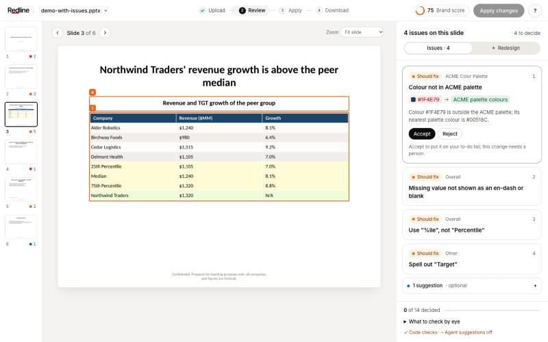

# Redline

**A brand-guideline checker for PowerPoint decks, and a worked example of how to build an AI product people can trust.** Upload a deck, see each issue highlighted on the slide, accept or reject each one, and download a corrected copy.

> **Code checks. AI suggests. You decide.** Code measures everything that can be measured: fonts, sizes, colours, positions, wording. An AI model is asked only for judgement calls, such as whether a headline states its point, and every suggestion it makes is checked against the slide before anyone sees it. Nothing changes until a person accepts it.

This repository is shared for teaching. It shows how I built Redline from scratch: the core you can build in an hour, the logic behind each decision, and what it took to grow that core into a full product.

**Start here:** [LESSON.md](LESSON.md) builds the core in one hour, in five steps, with a single script ([`lesson/core.py`](lesson/core.py)).



---

## Contents

1. [The problem](#1-the-problem)
2. [The core idea, in five steps](#2-the-core-idea-in-five-steps)
3. [How the full product works](#3-how-the-full-product-works)
4. [Key decisions, and why](#4-key-decisions-and-why)
5. [Frameworks and tools](#5-frameworks-and-tools)
6. [When the AI is wrong](#6-when-the-ai-is-wrong)
7. [Measuring it](#7-measuring-it)
8. [Running it](#8-running-it)
9. [Limits](#9-limits)

---

## 1. The problem

ACME, a fictional advisory firm, sends clients a lot of presentations. Every deck has to follow a detailed house style: fonts, sizes, positions, colours, table styling, terminology, a confidentiality statement on every slide, and a writing style. Checking by hand is slow and varies from reviewer to reviewer.

Three things decide whether a tool like this is any use:

| What matters | What it means for the design |
|---|---|
| **Low noise** | A reviewer must get through a 30-slide deck quickly. A flood of trivial or wrong flags is worse than no tool. |
| **Correct flags** | Every flag must be right and explain itself. AI output can't be taken on trust. |
| **Works on new decks** | It must work on decks it has never seen, not just the examples it was built against. |

The house style is in [`backend/app/config/acme-guidelines.md`](backend/app/config/acme-guidelines.md). It's an invented example, and, like real style guides, its own examples sometimes contradict its rules. [DECISIONS.md](DECISIONS.md) shows how each contradiction is resolved.

## 2. The core idea, in five steps

This is what [LESSON.md](LESSON.md) builds in an hour.

1. **Read the deck.** python-pptx gives you slides, shapes, paragraphs and runs.
2. **Resolve inheritance.** In real decks almost nothing is set on the text itself: size, font and colour come from the layout, the master or the theme. Work out the *effective* value of every property, and where it came from, before any rule runs. **The deck's own master is the spec**: the exact title box, bullet indents and confidentiality wording are read from it, which is what lets the tool work on decks it has never seen.
3. **Check what can be measured, in code.** A size, a colour, a position or a word is a fact. Code checks are exact, repeatable and free.
4. **Ask the model only for judgement, and verify it.** Does the headline state a conclusion? Are the bullets parallel? The model must quote the slide; if the quote isn't really there, or confidence is low, the suggestion is dropped. AI findings are always suggestions.
5. **Group repeats into one decision.** The same issue on twenty slides is one decision for the reviewer, not twenty. Noise is controlled in how findings are presented, never by hiding them.

## 3. How the full product works

```
 PPTX ─► Upload checks ─► Queue ─► Worker ─┬─► Render: LibreOffice → PDF → PNG per slide
                                           └─► Analyse:
                                                1. Extract, resolving inheritance (run → layout → master → theme)
                                                2. Classify elements (title, body, table, key, footnote, footer…)
                                                3. Deterministic rules           ┐
                                                4. Deck-consistency profile      ├─► Noise policy ─► Review UI
                                                5. AI review (Claude API), verified ┘
 Corrected PPTX ◄─ Re-check ◄─ Fix engine ◄─ accepted decisions ◄──────────────────────────┘
```

**For the reviewer**, every screen shows the same four steps: **Upload → Review → Apply → Download**.

1. **Upload a deck**, or reopen an earlier review with its decisions.
2. **Review each issue on the slide.** Slides render as images, with a numbered box on each issue and a card in plain language: *Must fix*, *Should fix* or *Suggestion*, what was found, what the guideline expects, and why.
3. **Accept or reject.** Each card says what accepting will do. Repeats fold into one decision ("same issue in 12 places: accept all"). Every decision can be undone. Keyboard: `J`/`K` slides, `A` accept, `R` reject, `T` to-do, `U` undo.
4. **Optional redesign.** On a slide with a dense table or text, the AI can suggest a clearer layout. It only *chooses* (a layout, which of the slide's own sentences to use, which column to chart); code writes every word, so nothing is invented.
5. **Apply.** Accepted changes are written to a copy, which is then checked again. A fix counts as **Fixed** only if the re-check no longer finds the issue. Before and after are shown side by side.
6. **Download** the corrected deck, a to-do list and a CSV report. The original file is never modified.

**What it checks**

| Checked by code (deterministic) | Checked by AI (judgement) |
|---|---|
| Fonts, sizes and weight of headlines, bullets, tables and footnotes | Does the headline state the takeaway? |
| Positions against the slide master; headlines longer than three lines | Are the bullets in a list parallel? |
| Bullet glyphs, indents and spacing by level | Sentence case, typos, misspelled names |
| Colours against the palette (exact match; near-misses named) | |
| Table header, zebra, statistics-row and client-row styling; missing values as an en-dash | |
| Confidentiality statement: present, unedited, in place, not overlapped | |
| Title slide: no "DRAFT", a valid date, authors present | |
| Terminology ("%ile", "Executive", no "TGT"); leftover reviewer comments | |
| Consistency across the deck: "Key" vs "Legend", key order, client name, header wording | |

**Beyond one house style.** A team can paste its own guideline, choose the checks to run (fonts and sizes by element, allowed colours, required wording) and save it as a versioned guideline. Lines that can't be checked automatically are listed for manual review rather than silently ignored.

More detail: [docs/ARCHITECTURE.md](docs/ARCHITECTURE.md), and line-by-line coverage of the guideline in [docs/GUIDELINE_COVERAGE.md](docs/GUIDELINE_COVERAGE.md).

## 4. Key decisions, and why

| Decision | Why |
|---|---|
| **Code checks, AI suggests, people decide** | Each part does what it's reliable at. Code is exact on facts; the model is useful on wording; a person is accountable for the result. |
| **Code first; AI only where judgement is needed** | Code checks are repeatable, inspectable and cost nothing per run. Asking a model whether a font is 16 pt invites a wrong answer to a question you could answer exactly. |
| **A fixed pipeline, not an agent loop** | The steps are known in advance: extract, check, ask the model about wording, group, show. A fixed pipeline is predictable, testable and cheap. An agent choosing its own steps would add cost and variance with no gain in accuracy. An agent earns its place where the steps can't be known up front. |
| **Never trust an AI flag unverified** | Every suggestion must quote text that is really on the slide and clear a confidence threshold. That filters invented output; it doesn't prove the suggestion is right, which is why a person still decides. |
| **The deck's master is the spec** | Reading expected values from the uploaded file is what makes the tool work on unseen decks. A deck not built on the house template is reported once, then checked against the written values instead. |
| **Control noise in presentation, not by hiding findings** | Every real issue is kept, but repeats are grouped, severities are ranked and uncertain items become suggestions. Capping or sampling findings would hide real problems. |
| **One written policy for contradictions** | Every written rule is checked. Where the guideline's own examples contradict it, the finding becomes a suggestion that states the dispute. See [DECISIONS.md](DECISIONS.md). |
| **Fixes are checked, not assumed** | A fix only counts if the corrected deck passes a re-check, and the original is never touched. |
| **Redesigns are opt-in and outside the issue count** | Suggesting more is the fastest way to add noise. A redesign is made only when asked, and offered only if it has fewer guideline issues than the original. |

## 5. Frameworks and tools

| Layer | Choice | Why |
|---|---|---|
| PPTX parsing | **python-pptx + lxml** | python-pptx for structure; direct XML for what it doesn't expose (inherited styles, theme colours, bullet glyphs, table-cell properties) |
| Rendering | **LibreOffice → PDF → PyMuPDF** | Free, headless rendering, so highlights sit on what the reviewer sees |
| API and jobs | **FastAPI** with an asyncio worker | Async I/O suits long render and analysis jobs; typed request and response models |
| Data contract | **Pydantic** | One `Finding`/`Deck` contract shared by analysis, AI, fixes and UI, so each part can be built and tested on its own |
| AI | **Claude API** through the Anthropic Python SDK: `claude-sonnet-5-5` for the per-slide wording review, `claude-opus-5-5` for redesigns | The review runs on every slide, so it uses the faster model; redesigns are rarer and need more judgement. Both return structured output through tool use. Without an API key the code checks still run. |
| State | **PostgreSQL** (SQLite locally) | Transactional queue claims with leases; ordered decision saves |
| Files | **Azure Blob Storage** (local disk in development) | Durable private storage, reached through a managed identity |
| Front end | **React + Vite + TypeScript** | A fast, typed UI without a heavy component framework |
| Hosting | **Azure Container Apps** | HTTPS, zero-downtime revisions, staged releases with rollback ([docs/DEPLOYMENT.md](docs/DEPLOYMENT.md)) |
| Quality | **pytest**, demo and seeded evaluations, axe-core accessibility audits | Accuracy is measured, not asserted |

**How it was built.** I wrote the data contract first (the `Finding` and `Deck` models in `backend/app/model/types.py`) and froze it, then built extraction, rules, AI review, fixes and the UI as separate tasks against it, each with acceptance criteria. I used AI coding assistants (Claude Code and OpenAI Codex) as development tools, and treated their output the way the product treats the model's: verified by tests and evaluations before it counted.

## 6. When the AI is wrong

Assume it sometimes will be. The design makes a wrong suggestion **unlikely to reach the reviewer, impossible to apply without them, and cheap to correct**.

| AI output | Checked in code | If it fails |
|---|---|---|
| Any wording suggestion | The quote must exist word for word on that slide; confidence at least 0.7; the rule must be one of the four AI rules | Dropped |
| | Typo and headline suggestions must be a drop-in replacement; parallel-bullet findings ask for a manual review of the whole list | Dropped |
| Redesign headline and bullets | Chosen by ID from the slide's own sentences, or a comparison code computed from the table; the model can't submit its own wording | Sent back with the reason; refused after two retries |
| Redesign chart | The model picks columns and rows only; code draws every bar from the table | Invalid choices removed, or redesign refused |

- **Nothing changes without a person.** AI suggestions are labelled, quote the slide and wait for Accept or Reject. AI wording changes are marked *Changed*, not *Fixed*, because code can't prove meaning.
- **Reproduce it.** AI results are cached by model, prompt version, rules and exact slide content, so the same deck returns the same suggestion for inspection.
- **Contain it.** Switch off one AI rule in `backend/app/config/rules.yaml`, or remove `ANTHROPIC_API_KEY` to turn the AI off entirely; the code checks keep running and the screen says *Agent review off*.
- **Fix it.** Add the case to the seeded AI evaluation (`eval/ai/`), adjust the prompt, and raise `PROMPT_VERSION`, which clears cached results.

**What it costs.** Code checks cost nothing per run. The AI review sends only slides with text, about one cent per slide at list prices (measured on a 24-slide deck), cached by content so checking the same deck again is free. Redesigns cost a few cents each, and run only on request.

## 7. Measuring it

Everything below can be rebuilt and re-run from this repository.

| Measure | Result |
|---|---|
| Planted issues in [`samples/demo-with-issues.pptx`](samples/demo-with-issues.pptx) caught by code | **13 of 13** code-checkable issues ([answer key](samples/demo-answer-key.yaml)); the 14th, bullet parallelism, is for the AI review |
| Findings on [`samples/demo-clean.pptx`](samples/demo-clean.pptx) | **0** |
| Seeded AI deck: planted writing problems found, false flags on clean slides | 10 of 10, 0 on 8 clean slides (measured before the prompt's examples were reworded for this public version; see [eval/README.md](eval/README.md)) |
| 30-minute soak, two reviews always in flight | 1,112 reviews, 0 failures, no slowdown or memory growth ([eval/soak](eval/soak/README.md)) |
| Automated tests | 413 back-end and 15 front-end tests |

The demo decks are generated from scratch by [`scripts/make_sample_decks.py`](scripts/make_sample_decks.py), so you can read exactly how each issue was planted and add your own.

## 8. Running it

```bash
python3 -m venv .venv && .venv/bin/pip install -r backend/requirements.txt
cd frontend && npm install && npm run build && cd ..
PYTHONPATH=backend .venv/bin/uvicorn app.main:app --env-file .env --port 8000
```

LibreOffice is needed for slide previews; alternatively `docker build -t redline .` and `docker run -p 127.0.0.1:8000:8000 --env-file .env redline`. The `.env` file (never committed) sets `APP_PASSWORD`, a random `SESSION_SECRET` of at least 32 characters, and optionally `ANTHROPIC_API_KEY` for the AI review. Without PostgreSQL and Blob Storage settings, reviews are stored locally in SQLite and on disk.

```bash
PYTHONPATH=backend .venv/bin/pytest backend/tests scripts/tests -q     # back-end tests
(cd frontend && npm test)                                              # front-end tests
.venv/bin/python lesson/core.py samples/demo-with-issues.pptx          # the one-hour core
.venv/bin/python scripts/make_sample_decks.py                          # rebuild the demo decks
```

### Repository layout

```
LESSON.md            build the core in an hour
lesson/core.py       the one-hour version, in one file
backend/app/model    extraction, inheritance resolution, element roles
backend/app/rules    deterministic and deck-consistency rules
backend/app/ai       AI review: prompt, quote verification
backend/app/fix      fix engine and layout guard (text never pushed out of its box)
backend/app/redesign.py   slide redesigns: the model chooses, code writes
backend/app          API, queue worker, state, storage, guidelines, rendering
backend/app/config   the example guideline, rule settings, palette
frontend/            review UI
samples/             demo template, demo decks and answer key (all generated)
eval/                evaluations
scripts/, infra/     deployment and deck generation
docs/                architecture, guideline coverage, deployment, accessibility
```

## 9. Limits

- **Visual judgement.** Chart styling, visual density and text inside images aren't checked automatically; the review screen lists them as checks to do by eye.
- **AI reliability is measured, not guaranteed.** Model output varies between runs. Keep planted problems and clean controls as regression checks.
- **Rendering.** LibreOffice can wrap text slightly differently from PowerPoint, so previews aren't pixel-perfect.
- **One shared password.** Fine for a demo; a real deployment needs single sign-on so every decision is recorded per person.
- **The demo decks are small.** They show each rule working; they are not evidence of accuracy on real client decks. The strongest evidence is reviewers scoring the tool on their own decks.

## Licence

MIT: see [LICENSE](LICENSE). Use, adapt and share the code freely, including in your own courses. The example guideline, demo decks and the companies and figures in them are fictional.
